Mermaid 把图表写成可以进入 Git、参与代码评审并随文档一起维护的文本。本篇以 Mermaid 11.16.0 和 Mermaid Live Editor 为基准，不只介绍常见流程图，也覆盖架构、数据分析、协议、项目管理和战略分析图表。

> 在线练习：[Mermaid Live Editor](https://mermaid.live/edit)。本文示例会在本站直接渲染；展开“查看 Mermaid 源码”即可复制到 Live Editor 修改。

这是一篇偏“完整手册”性质的文章。你不需要一次记住全部语法，先通过速查表选择合适的图，再进入对应章节复制一个最小示例即可。

## Mermaid 是什么

[Mermaid](https://mermaid.js.org/intro/) 是一个使用类 Markdown 文本描述图表的 JavaScript 工具。与在绘图软件中拖拽形状相比，它更适合技术文档：源码可以搜索、复制、比较差异，也可以和代码放在同一个仓库中。

一个最小 Mermaid 图表由两部分组成：第一行声明图表类型，后续各行描述节点、数据或关系。

```text
图表类型
  图表语句
  图表语句
```

Mermaid 的优势主要体现在：

- **文档即代码**：图表源码能够进入 Git，并在 Pull Request 中评审。
- **维护成本低**：修改节点名称或关系不需要重新对齐大量图形。
- **跨工具复用**：同一段源码可以用于 Mermaid Live、Markdown、Astro、GitHub 和其他文档平台。
- **可自动验证**：构建或测试阶段可以检查语法，减少发布后才发现图表损坏的情况。

它也不是万能的。需要像素级自由排版、复杂插画、海量交互数据或专业 BI 分析时，Figma、draw.io、D3、ECharts 等工具可能更合适。

## Mermaid Live Editor 使用方法

[Mermaid Live Editor](https://mermaid.live/edit) 是学习和调试 Mermaid 最直接的入口。

1. 在左侧 Code 区域输入 Mermaid 源码。
2. 编辑器会在预览区实时渲染图表。
3. 点击 Sample Diagrams，可以切换到流程图、架构图、Railroad、Wardley Map 等官方样例。
4. 在 Config 区域调整主题、布局和具体图表配置。
5. 使用导出功能生成 SVG 或 PNG；技术文档优先选择 SVG，因为缩放时更清晰。
6. 如果 Live Editor 能渲染而目标平台不能，先比较两边的 Mermaid 版本和外部插件支持情况。

Live Editor 的样例菜单会随着版本更新。本文覆盖 Mermaid 11.16.0 菜单中的主要图表类型，并对 beta、实验性和外部插件图表单独标记。

## Mermaid 最小语法

在 Markdown 中，通常使用语言名为 `mermaid` 的代码围栏：

````markdown
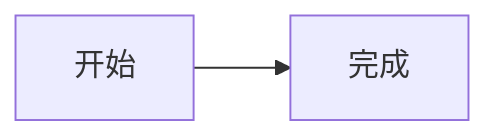
````

常见通用规则如下：

- `%%` 开头的内容是 Mermaid 注释。
- 图表类型通常必须位于第一条有效语句。
- 标识符尽量使用短英文，例如 `review`；展示文字放在 `[]`、`()` 或引号中。
- 含空格、标点或保留字的标签优先使用引号或节点标签语法。
- `LR` 表示从左到右，`TB` 或 `TD` 表示从上到下，`RL` 和 `BT` 表示反向布局。
- 同一文档宿主不一定支持 Mermaid 的最新语法，复制示例后应在目标环境中再次验证。

## 图表选择速查表

| 需求 | 推荐图表 | 重点回答的问题 |
| --- | --- | --- |
| 描述步骤、判断和分支 | Flowchart | 接下来发生什么？ |
| 表达跨角色、跨团队流程 | Swimlanes | 谁负责哪一步？ |
| 描述 API、服务或对象交互 | Sequence / ZenUML | 谁在什么时候向谁发送消息？ |
| 描述面向对象结构 | Class | 类有哪些字段、方法和关系？ |
| 描述数据库模型 | Entity Relationship | 实体之间是什么基数关系？ |
| 描述生命周期 | State | 一个对象如何从状态 A 进入状态 B？ |
| 描述系统边界 | C4 / Architecture | 系统由什么组成、边界在哪里？ |
| 描述模块占位和组合 | Block | 空间和模块如何组合？ |
| 追踪需求与实现 | Requirement | 哪个元素满足或验证哪个需求？ |
| 描述事件驱动业务 | Event Modeling | 信息如何随事件变化？ |
| 安排项目交付计划 | Gantt | 任务何时开始、持续多久？ |
| 展示 Git 分支策略 | Git Graph | 分支、提交与合并如何演进？ |
| 管理任务状态 | Kanban | 工作现在处于哪一列？ |
| 发散和整理概念 | Mindmap | 一个主题有哪些层次和分支？ |
| 展示目录或层级 | TreeView | 文件或对象如何嵌套？ |
| 比较比例 | Pie | 各部分占整体多少？ |
| 二维定位和优先级 | Quadrant | 对象在两个维度上处于哪里？ |
| 展示时间序列或类别数值 | XY Chart | 数值如何变化？ |
| 比较多维能力 | Radar | 多个对象在多个维度上谁更强？ |
| 展示流量分配 | Sankey | 数量从哪里流向哪里？ |
| 展示层级占比 | Treemap | 哪个层级、哪个部分占得更多？ |
| 展示集合交集 | Venn | 多个集合在哪里重叠？ |
| 描述报文字段 | Packet | 每一段比特位表示什么？ |
| 描述语法规则 | Railroad | 一段输入怎样才符合语法？ |
| 分析问题原因 | Ishikawa | 结果可能由哪些原因造成？ |
| 判断问题复杂度 | Cynefin Framework | 应该按最佳实践、专家分析还是试探处理？ |
| 分析产品和能力演进 | Wardley Map | 用户价值链上的能力成熟到什么阶段？ |
| 展示时间节点 | Timeline | 关键事件按什么顺序发生？ |
| 展示用户完成任务的体验 | User Journey | 哪一步体验好，哪一步需要改善？ |

## 主题与配置

Mermaid 支持在图表顶部使用 YAML frontmatter 设置标题、主题、外观和布局。下面的配置和图表会一起传给 Mermaid：


`theme` 控制配色基线，`look` 控制经典、手绘或 Neo 等外观，`layout` 控制支持该能力的布局引擎，`themeVariables` 用于覆盖颜色和字体变量。不同图表并不一定支持所有布局和外观组合。

本文所在站点固定使用 `securityLevel: strict`。文章中的 frontmatter 可以改变主题和图表配置，但不能降低站点级安全策略。完整配置可查阅 [Mermaid 配置文档](https://mermaid.js.org/config/configuration.html) 和 [配置 Schema](https://mermaid.js.org/config/schema-docs/config.html)。

## 一、流程与交互建模

### 1. Flowchart：流程图

Flowchart 是使用频率最高的 Mermaid 图表，适合表达顺序、条件、循环和处理结果。只关心“步骤如何流动”时，优先选择流程图。

**适合：**业务流程、算法步骤、发布流程、故障排查树、审批分支。

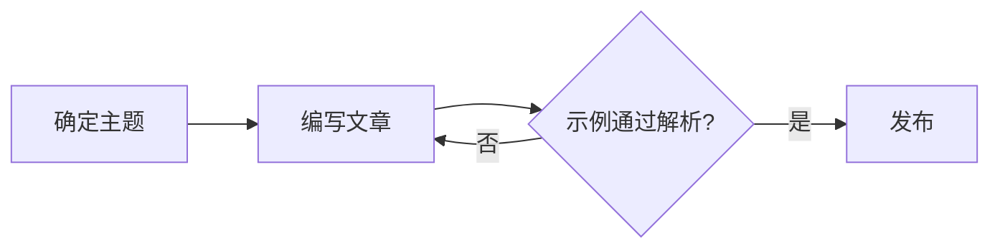

**关键语法：**`A[文字]` 定义矩形节点，`C{问题}` 定义判断节点，`-->` 建立有向连线，`-->|标签|` 给连线增加说明。方向可以使用 `LR`、`TB`、`RL` 或 `BT`。

**注意：**节点 ID 和显示文字最好分离。ID 使用英文，中文放在括号中，可以减少保留字、空格和标点造成的解析问题。

官方文档：[Flowcharts Syntax](https://mermaid.js.org/syntax/flowchart.html)

### 2. Swimlanes：泳道图

泳道图在流程图基础上增加“责任边界”。它不仅告诉读者下一步是什么，还明确每一步由哪个角色、团队或系统负责。

**适合：**跨部门审批、客户支持升级、订单履约、研发交付、人工与系统协同流程。

```mermaid
swimlane-beta LR
  subgraph Author [作者]
    draft[编写草稿]
    revise[修改内容]
  end
  subgraph Reviewer [评审者]
    review{是否通过?}
  end
  subgraph Site [博客系统]
    publish[构建并发布]
  end
  draft --> review
  review -->|通过| publish
  review -->|修改| revise --> review
```

**关键语法：**以 `swimlane-beta` 开头，顶层 `subgraph ... end` 会渲染成泳道；节点和连线沿用 Flowchart 语法。

**注意：**Swimlanes 从 Mermaid 11.16.0 开始提供，仍是新图表类型。旧版 Mermaid 会报 `UnknownDiagramError`，语法未来也可能调整。

官方文档：[Swimlanes Diagram](https://mermaid.js.org/syntax/swimlanes)

### 3. Sequence：时序图

时序图强调参与者之间的消息顺序。横向是参与者，纵向是时间，非常适合说明一次请求穿过浏览器、服务和数据库的过程。

**适合：**API 调用、登录认证、微服务交互、异步消息、前后端请求链路。

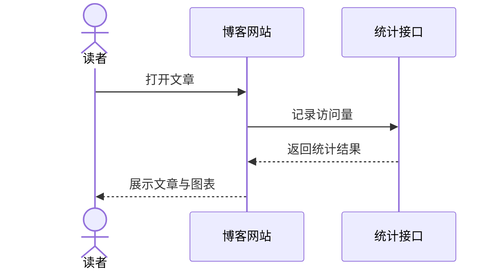

**关键语法：**`participant` 定义普通参与者，`actor` 定义用户角色，`->>` 表示同步消息，`-->>` 常用于响应。还可以使用 `alt`、`opt`、`loop`、`par` 描述分支、可选和并行交互。

**注意：**消息过多时不要把整个系统塞进一张图。围绕一个用户目标或一次事务拆分，通常比展示全部服务更容易读。

官方文档：[Sequence diagrams](https://mermaid.js.org/syntax/sequenceDiagram.html)

### 4. State：状态图

状态图关注一个对象的生命周期，而不是多个角色的消息。它适合描述“当前是什么状态”和“什么事件会触发状态迁移”。

**适合：**订单状态、文章发布状态、设备连接状态、任务生命周期、有限状态机。

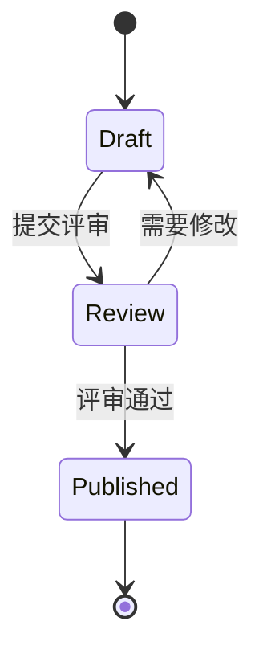

**关键语法：**`[*]` 表示开始或结束，`A --> B: 事件` 表示由事件触发的状态迁移。复杂状态可以使用 `state 名称 { ... }` 嵌套。

**注意：**不要把状态和动作混为一谈。“已发布”是状态，“点击发布按钮”是触发事件。状态名称通常适合用名词或过去分词。

官方文档：[State diagrams](https://mermaid.js.org/syntax/stateDiagram.html)

### 5. User Journey：用户旅程图

用户旅程图按阶段展示用户完成任务的步骤，并用 1 到 5 的分数表达体验好坏。它比流程图更关注感受，而不是系统内部实现。

**适合：**产品体验分析、注册流程、购买流程、学习路径、客服体验复盘。

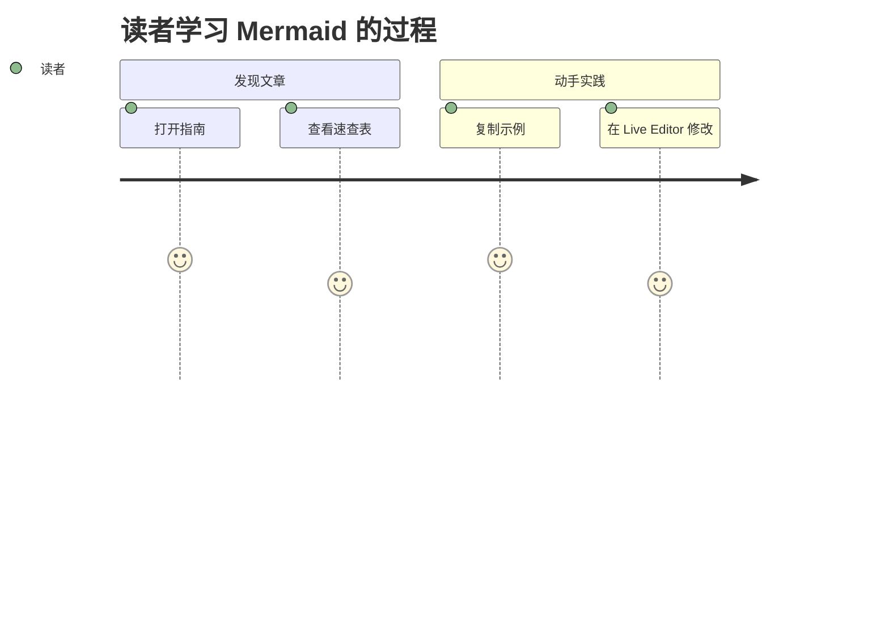

**关键语法：**`section` 划分阶段，任务格式是 `任务名称: 分数: 参与者`，分数范围是 1 到 5。

**注意：**旅程图中的分数是调研或评估结果，不是精确性能指标。多人旅程要保持角色数量可控，否则颜色和标签会迅速变乱。

官方文档：[User Journey Diagram](https://mermaid.js.org/syntax/userJourney.html)

### 6. Timeline：时间线

Timeline 用于展示按时间或阶段排序的事件。它比 Gantt 更轻量，不要求任务持续时间，也不强调依赖关系。

**适合：**版本演进、事故复盘、项目里程碑、产品历史、一天的关键节点。

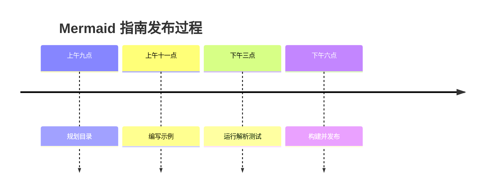

**关键语法：**使用 `时间或阶段 : 事件` 添加节点，一个时间段后可以继续写多个 `: 事件`。

**注意：**时间文本本身包含冒号时可能与分隔符冲突，例如 `09:00`。可以改用 `09时00分`、`上午九点` 或其他不含冒号的标签。

官方文档：[Timeline Diagram](https://mermaid.js.org/syntax/timeline)

## 二、软件与系统设计

### 7. Class：类图

类图描述类、属性、方法以及类之间的继承、组合、聚合和依赖关系，是面向对象设计中最常用的结构图。

**适合：**领域模型、SDK 设计、后端实体、设计模式、重构说明。

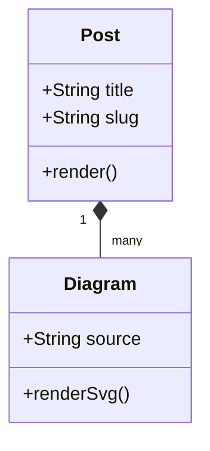

**关键语法：**`class Name { ... }` 定义类，`+`、`-`、`#` 表示 public、private、protected。`<|--` 是继承，`*--` 是组合，`o--` 是聚合，`..>` 是依赖。

**注意：**类图适合解释稳定结构，不适合展示一次请求的先后顺序；交互过程应使用 Sequence 或 ZenUML。

官方文档：[Class diagrams](https://mermaid.js.org/syntax/classDiagram.html)

### 8. Entity Relationship：实体关系图

ER 图描述数据实体、字段和实体间基数关系，重点是“一对一、一对多还是多对多”。

**适合：**关系型数据库设计、内容模型、业务数据字典、表结构评审。

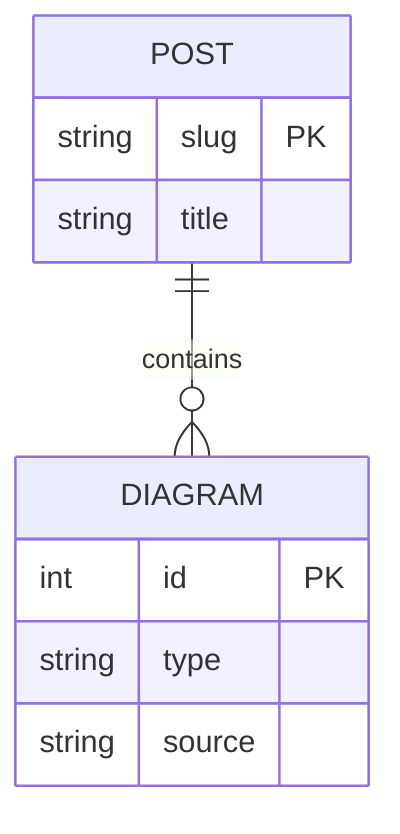

**关键语法：**`||--o{` 表示左侧恰好一个、右侧零个或多个。实体块中可以使用 `PK`、`FK`、`UK` 标记键。

**注意：**ER 图表达的是逻辑模型，不会自动生成迁移脚本，也不替代数据库约束和索引设计。

官方文档：[Entity Relationship Diagrams](https://mermaid.js.org/syntax/entityRelationshipDiagram)

### 9. Architecture：架构图

Architecture 图使用 group、service、junction 和 edge 表达基础设施或系统组件，图形语义比普通流程图更接近云架构图。

**适合：**Web 系统架构、云服务依赖、数据链路、部署边界、基础设施概览。

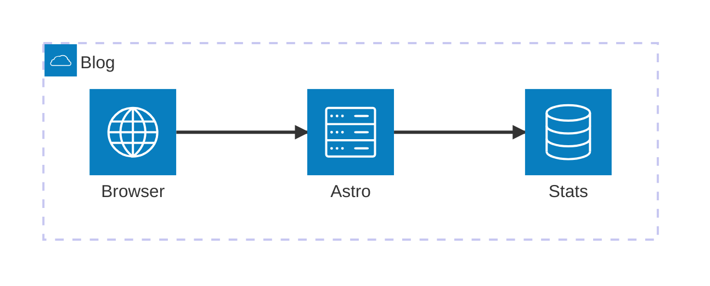

**关键语法：**`group id(icon)[label]` 创建分组，`service id(icon)[label] in group` 创建服务，连接端口使用 `L`、`R`、`T`、`B` 指定左右上下方向。

**注意：**Architecture 仍使用 beta 关键字。标识符、图标名和部分标签语法比较严格；遇到解析错误时，先把内部 ID 和标签改成短英文，再逐步增加展示文字。

官方文档：[Architecture Diagrams](https://mermaid.js.org/syntax/architecture.html)

### 10. Block：块图

Block 图强调网格、列宽和模块占位，适合在普通自动布局无法表达空间关系时手动控制结构。

**适合：**模块分区、硬件组成、页面区域、处理管线、系统分层草图。

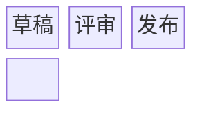

**关键语法：**`columns N` 设置列数，节点按声明顺序进入网格；`space` 可以留空，块还可以设置跨列宽度和嵌套 block。

**注意：**Block 图的优势是控制位置，但手动布局也意味着节点增加后需要重新调整列数和占位。

官方文档：[Block Diagram](https://mermaid.js.org/syntax/block.html)

### 11. C4：系统上下文图

C4 模型从 System Context、Container、Component 到 Deployment 分层描述软件架构。下面使用最顶层的 Context 图展示系统与用户、外部系统的关系。

**适合：**系统边界、微服务容器、组件职责、部署节点、架构评审。

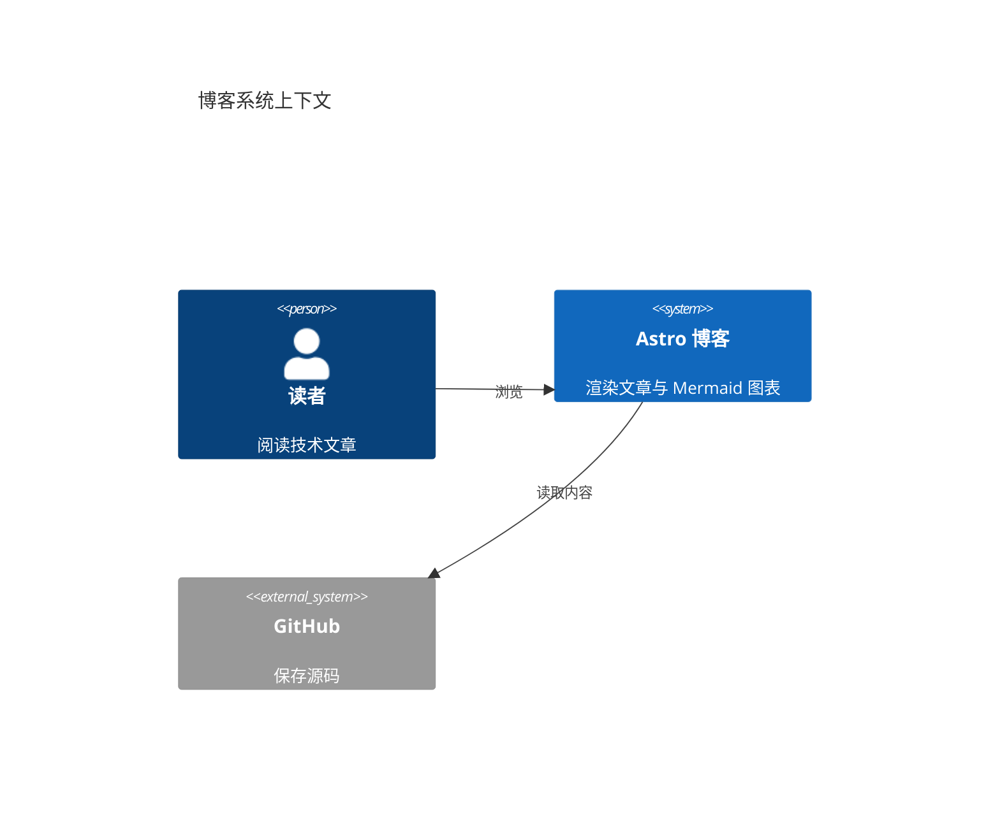

**关键语法：**常用入口包括 `C4Context`、`C4Container`、`C4Component`、`C4Dynamic` 和 `C4Deployment`，元素通过 `Person`、`System`、`Container`、`Component` 与 `Rel` 定义。

**注意：**Mermaid 官方仍把 C4 标记为实验性图表，语法与 C4-PlantUML 相近但并非全部兼容；样式和自动布局能力也有限。

官方文档：[C4 Diagrams](https://mermaid.js.org/syntax/c4)

### 12. Requirement：需求图

Requirement 图借鉴 SysML，用来表达需求、设计元素以及满足、验证、追踪等关系。

**适合：**系统工程、合规需求、验收标准、需求追踪矩阵、测试覆盖说明。

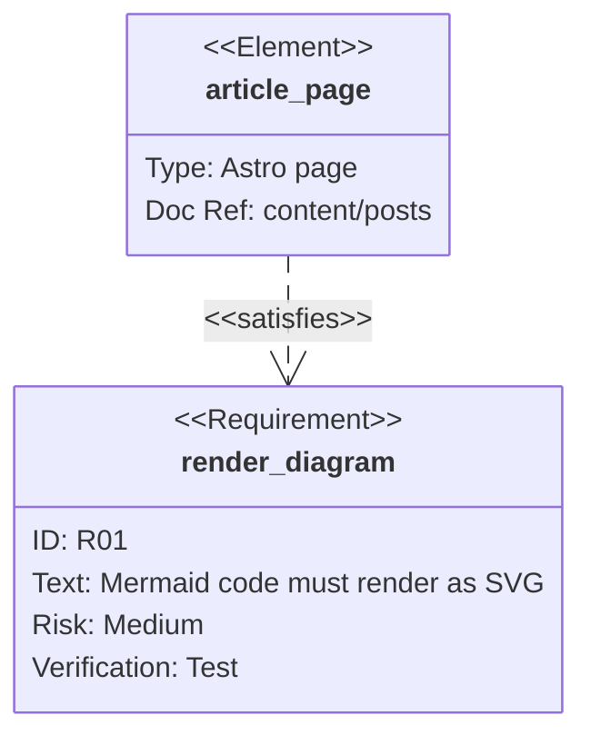

**关键语法：**需求包含 `id`、`text`、`risk` 和 `verifymethod`。关系包括 `contains`、`copies`、`derives`、`satisfies`、`verifies`、`refines` 和 `traces`。

**注意：**枚举值应使用官方支持的风险等级和验证方法。复杂文本最好放在引号中，ID 避免使用容易被解析器误判的标点。

官方文档：[Requirement Diagram](https://mermaid.js.org/syntax/requirementDiagram)

### 13. Event Modeling：事件建模图

Event Modeling 沿时间线描述 UI、命令、事件、读模型和处理器，让事件驱动系统的信息变化变得可见。

**适合：**事件溯源、CQRS、业务流程发现、领域事件设计、自动化处理链路。

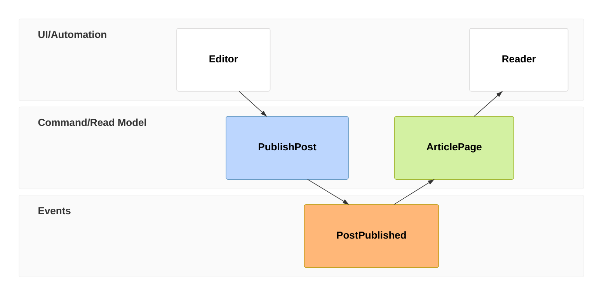

**关键语法：**`tf` 是 timeframe 的紧凑写法；类型包括 `ui`、`cmd`、`evt`、`rmo` 和 `pcr`。`rf` 可以重置推断关系，`->>` 可以显式引用多个来源帧。

**注意：**Event Modeling 从 Mermaid 11.15.0 开始提供。时间帧编号必须唯一；实体标识符可以通过命名空间形成更多泳道。

官方文档：[Event Modeling Diagram](https://mermaid.js.org/syntax/eventmodeling.html)

## 三、项目与研发管理

### 14. Gantt：甘特图

Gantt 图展示任务的开始时间、持续时间、依赖和状态，是项目计划和交付排期的经典表达方式。

**适合：**版本计划、内容排期、研发里程碑、迁移项目、发布窗口。

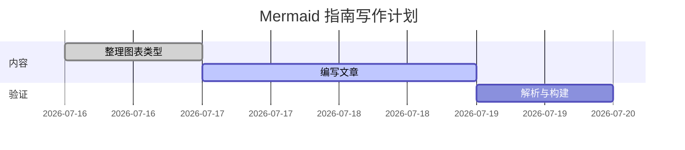

**关键语法：**`dateFormat` 决定日期格式，任务可以用固定日期、持续时间或 `after taskId` 建立依赖；`done`、`active`、`crit` 表示状态。

**注意：**日期必须严格匹配 `dateFormat`。甘特图适合计划，不适合记录大量即时状态；日常任务流更适合 Kanban。

官方文档：[Gantt diagrams](https://mermaid.js.org/syntax/gantt.html)

### 15. Git Graph：Git 分支图

Git Graph 用接近 Git 操作的声明展示 commit、branch、checkout 和 merge，适合解释分支策略与发布历史。

**适合：**Git Flow、功能分支、Hotfix 流程、版本合并策略、事故提交回溯。

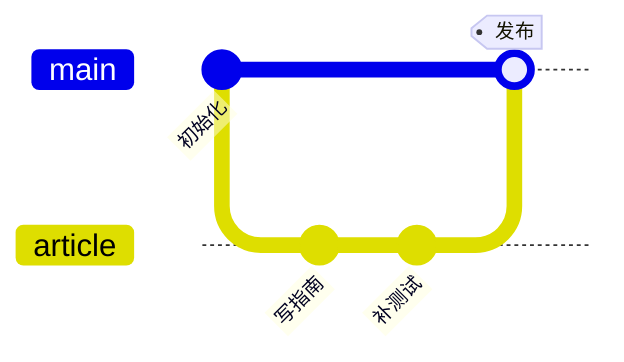

**关键语法：**`commit` 创建提交，`branch` 创建并切换分支，`checkout` 或 `switch` 切换分支，`merge` 合并分支。提交支持 `id`、`tag` 和类型。

**注意：**它用于讲解分支模型，不会读取真实 Git 历史。真实仓库分析仍应使用 `git log --graph`、`git show` 和 `git diff`。

官方文档：[GitGraph Diagrams](https://mermaid.js.org/syntax/gitgraph.html)

### 16. Kanban：看板

Kanban 用列表示状态，用卡片表示工作项，可以快速展示当前工作分布和在制品。

**适合：**研发任务、内容写作、需求流转、个人待办、迭代进度。

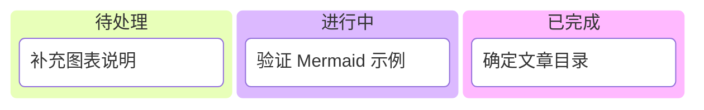

**关键语法：**顶层项是看板列，缩进一级的项是卡片。列和卡片都应使用稳定 ID，并把展示文字放入 `[]`。

**注意：**Mermaid Kanban 是文档快照，不是可拖拽任务系统。需要负责人、评论、自动化和实时状态时，应使用真正的项目管理工具。

官方文档：[Kanban Diagram](https://mermaid.js.org/syntax/kanban.html)

### 17. Mindmap：思维导图

Mindmap 以中心主题向外展开层级，适合在写作或设计早期整理概念和知识结构。

**适合：**文章大纲、知识地图、需求脑暴、技术选型、学习路线。

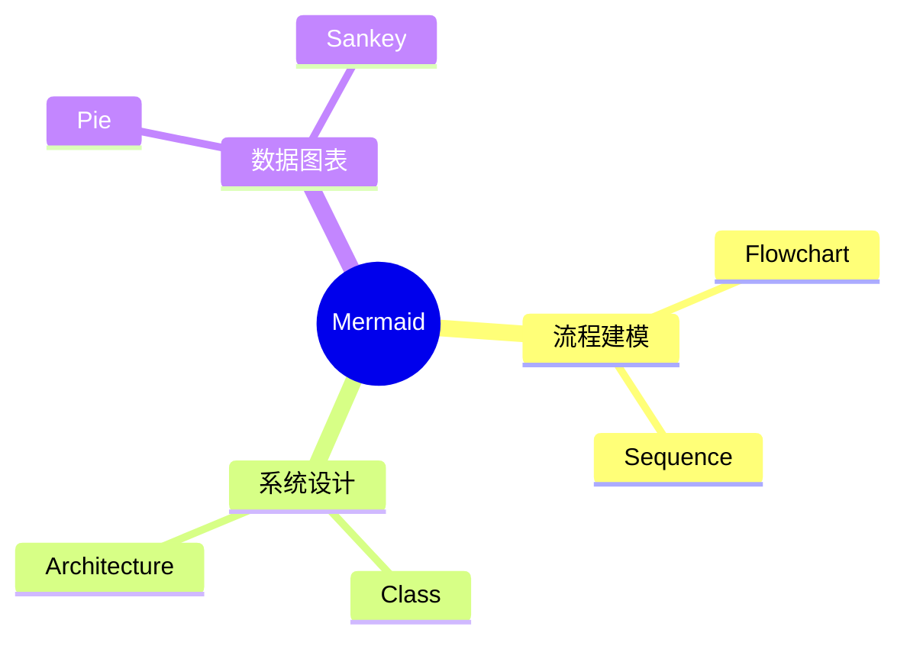

**关键语法：**缩进决定父子关系，`root((文字))` 定义中心节点；节点可以使用不同括号获得不同形状。

**注意：**层级过深会让文字变小、连线拥挤。思维导图适合发散和分类，不适合表达严格执行顺序。

官方文档：[Mindmap](https://mermaid.js.org/syntax/mindmap)

### 18. TreeView：目录树

TreeView 把缩进文本渲染成文件目录或层级树，特别适合展示仓库结构。

**适合：**代码目录、文档信息架构、模块层级、配置树、对象嵌套关系。


**关键语法：**`treeView-beta` 后用缩进建立层级；名称以 `/` 结尾时表示目录。也支持 `├──`、`└──` 等框线字符输入。

**注意：**TreeView 从 Mermaid 11.14.0 开始提供。图标默认关闭，外部图标包需要宿主额外注册，文章示例不要假定图标包一定存在。

官方文档：[TreeView Diagram](https://mermaid.js.org/syntax/treeView.html)

## 四、数据与统计图表

### 19. Pie：饼图

Pie 用扇区展示各部分占整体的比例，适合类别较少、差异明显的组成分析。

**适合：**内容占比、预算分配、流量来源、缺陷类别、时间使用情况。

```mermaid
pie showData title 文章内容占比
  "图表示例" : 55
  "语法说明" : 25
  "扩展与排错" : 20
```

**关键语法：**`pie title` 设置标题，`showData` 显示数值，每个类别使用 `"标签" : 数值`。

**注意：**类别超过五六个或数值接近时，饼图很难比较；此时条形图或 XY Chart 通常更清晰。

官方文档：[Pie Chart](https://mermaid.js.org/syntax/pie.html)

### 20. Quadrant：象限图

Quadrant 把对象放到两个维度形成的四个象限中，适合展示定位、优先级和组合策略。

**适合：**技术选型、需求优先级、风险收益、用户分群、产品定位。

```mermaid
quadrantChart
  title 图表选型
  x-axis 低结构化 --> 高结构化
  y-axis 低时间性 --> 高时间性
  quadrant-1 时序与计划
  quadrant-2 探索与分析
  quadrant-3 概念整理
  quadrant-4 系统建模
  "Mindmap": [0.20, 0.25]
  "Sequence": [0.75, 0.85]
  "ER": [0.85, 0.30]
  "Timeline": [0.35, 0.80]
```

**关键语法：**点坐标范围是 0 到 1，`x-axis`、`y-axis` 描述坐标含义，`quadrant-1` 到 `quadrant-4` 命名象限。

**注意：**坐标通常来自团队判断或模型评分，应说明依据，避免把主观定位伪装成精确测量。

官方文档：[Quadrant Chart](https://mermaid.js.org/syntax/quadrantChart.html)

### 21. XY Chart：XY 图

XY Chart 可以绘制折线和柱形数据，适合展示随时间或类别变化的数值。

**适合：**访问量、构建时间、版本性能、类别对比、简单趋势分析。

```mermaid
xychart-beta
  title "文章访问量"
  x-axis [1, 2, 3, 4, 5]
  y-axis "访问次数" 0 --> 100
  line [20, 35, 52, 76, 92]
  bar [15, 28, 45, 60, 80]
```

**关键语法：**`x-axis` 定义类别或数值范围，`y-axis` 定义刻度范围，`line` 和 `bar` 分别添加折线与柱形系列。

**注意：**XY Chart 是轻量图表，不适合多轴、复杂 tooltip、大数据缩放等专业交互分析场景。

官方文档：[XY Chart](https://mermaid.js.org/syntax/xyChart.html)

### 22. Radar：雷达图

Radar 用多个放射轴比较对象的多维能力，适合展示“整体轮廓”而不是某个单值排名。

**适合：**能力模型、方案对比、团队技能、产品指标、质量维度。

```mermaid
radar-beta
  title 文档质量对比
  axis c["完整性"], r["可读性"], m["可维护性"], v["可验证性"]
  curve before["普通文档"]{60, 70, 45, 40}
  curve after["Mermaid 文档"]{90, 82, 88, 92}
  max 100
  min 0
```

**关键语法：**`axis id["标签"]` 定义维度，`curve id["名称"]{值列表}` 定义数据系列；`max`、`min`、`ticks`、`graticule` 控制刻度。

**注意：**所有曲线必须使用相同维度和量纲。Radar 标签建议用引号包裹，尤其是中文、空格或标点标签。

官方文档：[Radar Diagram](https://mermaid.js.org/syntax/radar.html)

### 23. Sankey：桑基图

Sankey 用连线宽度表示数量从一个节点流向另一个节点，适合观察分流、损耗和转换。

**适合：**转化漏斗、能源流、资金流、用户路径、任务返工比例。

```mermaid
sankey-beta
Draft,Review,10
Review,Publish,8
Review,Revise,2
Revise,Review,2
```

**关键语法：**每行是 CSV 三元组 `来源,目标,数值`，数值决定流带宽度。

**注意：**Sankey 语法对逗号和换行敏感。节点名称包含逗号时需要使用正确的 CSV 转义；部分环境对非 ASCII CSV 标签支持存在差异，发布前应实际渲染检查。

官方文档：[Sankey Diagram](https://mermaid.js.org/syntax/sankey.html)

### 24. Treemap：矩形树图

Treemap 用嵌套矩形同时表达层级和数值占比，能在有限空间中展示大量分类。

**适合：**磁盘占用、内容分类、预算结构、代码模块规模、资产组合。

```mermaid
treemap-beta
  "Mermaid 指南"
    "流程与交互": 30
    "系统设计": 25
    "数据图表": 20
    "项目管理": 15
    "扩展与排错": 10
```

**关键语法：**缩进建立层级，叶子节点使用 `"名称": 数值`，上层分类只写名称。

**注意：**Treemap 擅长比较面积，不适合精确读取数值；重要数据应同时提供表格或标签。

官方文档：[Treemap](https://mermaid.js.org/syntax/treemap.html)

### 25. Venn：维恩图

Venn 图用重叠集合表达共同部分。Mermaid 新版支持两个或多个集合及高阶交集。

**适合：**能力交集、用户群重叠、方案共同点、岗位技能、产品定位。

```mermaid
venn-beta
  title "技术文章质量"
  set Accurate["准确"]
  set Clear["清晰"]
  set Practical["实用"]
  union Accurate,Clear,Practical["高质量文章"]
```

**关键语法：**`set` 定义集合，`union A,B` 定义交集，方括号内是展示标签；还可以使用 `:N` 设置集合或交集大小。

**注意：**Venn 从 Mermaid 11.12.3 开始提供，语法仍可能演进。集合太多时重叠区域难以解释，应改用矩阵或 UpSet 图。

官方文档：[Venn diagrams](https://mermaid.js.org/syntax/venn.html)

## 五、网络、协议与语法

### 26. Packet：数据包图

Packet 图按比特范围展示协议头、寄存器或二进制结构中的字段。

**适合：**网络报文、文件格式、CPU 寄存器、嵌入式协议、二进制数据结构。

```mermaid
packet-beta
  0-3: "版本"
  4-7: "头长度"
  8-15: "消息类型"
  16-31: "负载长度"
```

**关键语法：**每行使用 `起始位-结束位: "字段名称"`，位范围应连续、清晰，并与协议定义一致。

**注意：**Packet 图只负责可视化字段位置，不会验证位宽总和、端序或协议语义，需要测试和解析器提供真正约束。

官方文档：[Packet Diagram](https://mermaid.js.org/syntax/packet.html)

### 27. Railroad ABNF：ABNF 语法铁路图

ABNF 是互联网协议和 RFC 中常见的语法表示法。Railroad ABNF 把规则、重复、选择和字符范围转换成可视化路径。

**适合：**HTTP 头、文本协议、RFC 语法、命令格式、接口输入规范。

```mermaid
railroad-abnf-beta
  title "文章路由 ABNF"
  route = "/posts/" slug ["/"];
  slug = 1*(ALPHA / DIGIT / "-");
```

**关键语法：**`/` 表示选择，空格连接连续元素，`1*` 表示至少一次，`[]` 表示可选，`%x30-39` 可表示十六进制字符范围。

**注意：**Mermaid 11.16.0 的 Railroad ABNF 仍是 beta，并要求规则以分号结束，这与一些传统 ABNF 文档的换行结束习惯不同。

当前可在 [Mermaid Live Editor](https://mermaid.live/edit) 的 Railroad ABNF 样例中练习；配置定义可参考 [Mermaid Config Schema](https://mermaid.js.org/config/schema-docs/config.html)。

### 28. Railroad EBNF：EBNF 语法铁路图

EBNF 在 BNF 基础上增加可选、重复和分组语法，适合表达编程语言或配置文件结构。

**适合：**DSL、配置语法、查询语言、表达式语法、解析器文档。

```mermaid
railroad-ebnf-beta
  title "文章路由 EBNF"
  route = "/posts/", slug, ["/"];
  slug = letter, {letter | digit | "-"};
```

**关键语法：**`,` 表示序列，`|` 表示选择，`[]` 表示可选，`{}` 表示重复，规则以 `;` 结束。

**注意：**EBNF 存在多个方言。Mermaid 接受 `=` 或 `::=`，但仍应按 Mermaid 解析器支持的语法验证，而不是假设任意 EBNF 文本都能直接渲染。

当前可在 [Mermaid Live Editor](https://mermaid.live/edit) 的 Railroad EBNF 样例中练习。

### 29. Railroad IR：中间表示铁路图

Railroad IR 是 Mermaid 自己的显式表达式语法。它不依赖某个外部语法标准，而是直接用 `sequence`、`choice`、`optional` 等构造器描述铁路图。

**适合：**程序生成图表、教学演示、跨语法中间层、需要精确控制铁路节点类型的场景。

```mermaid
railroad-beta
  title "文章路由 IR"
  route = sequence(terminal("/posts/"), nonterminal("slug"), optional(terminal("/")));
  slug = oneOrMore(choice(terminal("a-z"), terminal("0-9"), terminal("-")));
```

**关键语法：**可组合 `sequence`、`choice`、`optional`、`oneOrMore`、`zeroOrMore`、`terminal`、`nonterminal` 和 `special`，规则必须以分号结束。

**注意：**这不是 IETF、ISO 或 W3C 定义的通用语法格式，更像 Mermaid Railroad 渲染器的中间表示。它适合生成和控制，不适合直接复制现有语言规范。

当前可在 [Mermaid Live Editor](https://mermaid.live/edit) 的 Railroad IR 样例中练习。

### 30. Railroad PEG：PEG 语法铁路图

PEG 使用有序选择描述解析规则。与上下文无关文法不同，`A / B` 会优先尝试 A，只有 A 失败才尝试 B。

**适合：**递归下降解析器、语法解析库、命令语言、模板语言、路由规则。

```mermaid
railroad-peg-beta
  title "文章路由 PEG"
  route <- "/posts/" slug "/"?;
  slug <- (letter / digit / "-")+;
```

**关键语法：**`<-` 定义规则，`/` 表示有序选择，`?`、`*`、`+` 表示可选、零次以上和一次以上，`&` 与 `!` 表示正向和负向断言。

**注意：**Mermaid 的 PEG Railroad 规则同样要求分号结尾。PEG 的选择具有顺序含义，调整候选项顺序可能改变语言匹配结果。

当前可在 [Mermaid Live Editor](https://mermaid.live/edit) 的 Railroad PEG 样例中练习。

## 六、分析与战略图表

### 31. Cynefin Framework：复杂度框架图

Cynefin Framework 把问题分为 Clear、Complicated、Complex、Chaotic 和 Confusion，帮助团队为不同问题选择不同决策方式。

**适合：**事故响应、产品探索、组织决策、技术治理、任务分类。

```mermaid
cynefin-beta
  title 博客故障处理
  complex
    "探索未知渲染问题"
  complicated
    "分析构建性能"
  clear
    "修复已知语法错误"
  chaotic
    "站点完全不可用"
  confusion
    "尚未分类的告警"
  chaotic --> complex : "服务恢复"
```

**关键语法：**五个领域名称是固定关键字；领域下方放置引号包裹的事项，`domain --> domain : "说明"` 表示问题在领域之间迁移。

**注意：**Cynefin 从 Mermaid 11.16.0 开始提供。它用于“理解问题类型”，不是简单的难度高低排序；Complex 应通过试探发现模式，Complicated 则依赖分析和专家知识。

官方文档：[Cynefin Framework Diagram](https://mermaid.js.org/syntax/cynefin.html)

### 32. Ishikawa：鱼骨图

Ishikawa 又称鱼骨图或因果图，以结果为鱼头、主要原因类别为大骨、具体原因为分支，用于系统分析问题来源。

**适合：**质量分析、故障复盘、性能问题、流程缺陷、根因讨论。

```mermaid
ishikawa-beta
  文章中的图表无法渲染
    内容
      Mermaid 语法错误
      使用了旧版不支持的图表
    构建
      依赖版本不一致
      代码块语言标记错误
    浏览器
      JavaScript 被禁用
      页面脚本加载失败
```

**关键语法：**第一行是结果或问题，后续缩进层级表示主要原因和子原因。

**注意：**Ishikawa 从 Mermaid 11.12.3 开始提供，仍属于新图表。鱼骨图列出的是原因假设，最终根因还需要日志、数据和实验验证。

官方文档：[Ishikawa diagram](https://mermaid.js.org/syntax/ishikawa.html)

### 33. Wardley Map：沃德利地图

Wardley Map 同时展示用户可见度和能力演进阶段，用来分析价值链、构建或采购策略以及能力未来的移动方向。

**适合：**平台战略、技术自研与采购决策、产品能力演进、价值链分析、云化规划。

```mermaid
wardley-beta
  title 技术博客价值链
  anchor Reader [0.95, 0.90]
  component Article [0.80, 0.70]
  component Mermaid Renderer [0.60, 0.45]
  component Astro [0.40, 0.75]
  component Cloud Platform [0.20, 0.92]
  Reader -> Article
  Article -> Mermaid Renderer
  Mermaid Renderer -> Astro
  Astro -> Cloud Platform
```

**关键语法：**`anchor` 表示用户或核心需求，`component` 表示能力；坐标顺序是 `[visibility, evolution]`，不是常见的 `[x, y]`。`evolve` 可表示未来移动，`(build)`、`(buy)` 等可表示采购策略。

**注意：**Wardley Map 从 Mermaid 11.14.0 开始提供。坐标来自战略判断，需要结合用户研究、市场成熟度和组织约束，而不是单纯追求图形漂亮。

官方文档：[Wardley Maps](https://mermaid.js.org/syntax/wardley.html)

## 七、其他建模语法

### 34. ZenUML：另一种时序建模语法

ZenUML 同样描述交互顺序，但语法更接近程序调用、嵌套代码块和控制结构。它可以表达同步调用、异步消息、返回值、循环和异常处理。

**适合：**面向代码的交互设计、嵌套调用、条件与循环、开发者熟悉的伪代码式时序说明。

```mermaid
zenuml
  title 文章加载流程
  @Actor Reader
  Browser
  Astro
  Reader->Browser: Open article
  Browser->Astro: Load page
  Astro->Browser: Return HTML
  Browser->Reader: Show diagrams
```

**关键语法：**参与者可以显式声明或按首次出现推断，`A->B: message` 表示异步消息；方法调用、`if`、`while`、`try/catch/finally` 和嵌套 `{}` 可以表达更接近代码的交互。

**注意：**ZenUML 是 Mermaid 的外部图表插件，宿主必须额外安装 `@mermaid-js/mermaid-zenuml` 并通过 `registerExternalDiagrams` 注册。Mermaid Live 已注册该插件，但其他 Markdown 平台不一定支持。

官方文档：[ZenUML](https://mermaid.js.org/syntax/zenuml.html)

## Mermaid 的主题、样式与布局扩展

### 主题

Mermaid 常见主题包括：

- `default`：默认彩色主题。
- `base`：最适合通过 `themeVariables` 深度定制。
- `dark`：适合深色页面。
- `forest`：绿色系主题。
- `neutral`：偏黑白和打印友好。
- `neo`、`neo-dark`：新版 Neo 外观主题。
- `redux`、`redux-dark`、`redux-color`、`redux-dark-color`：Redux 系列主题。

主题集合会随 Mermaid 版本变化，目标宿主可能还停留在旧版本。不要只在 Live Editor 中检查颜色，还要在实际博客、文档站或代码托管平台中验证。

### classDef、class 和 direction

Flowchart 等图表支持用 `classDef` 定义可复用样式，再通过 `class` 应用到节点：

```mermaid
flowchart LR
  source[Mermaid 源码] --> parser[解析器] --> svg[SVG 图表]
  classDef input fill:#0b1f36,stroke:#28f7ff,color:#f0fdff;
  classDef output fill:#24102d,stroke:#ff47df,color:#f0fdff;
  class source input;
  class svg output;
```

`direction` 或图表声明后的方向参数可以改变布局，但不同图表的方向语法并不完全一致。Flowchart 使用 `flowchart LR`，Requirement 可以在图表内部使用 `direction LR`，而 Gantt、Pie 等图表并不采用同样的方向模型。

### 布局引擎

Mermaid 常见布局包括 Dagre 和 ELK，部分新图还支持专用布局。布局能力取决于图表类型和宿主打包方式；例如 C4、Wardley、Cynefin 等使用专用渲染器，不一定响应通用 `layout` 配置。

## 无障碍与安全级别

Mermaid 支持 `accTitle` 和 `accDescr`，用于给 SVG 图表提供无障碍标题与描述。重要图表应在正文中保留文字解释，不能只依赖图形表达信息。

常见安全级别包括：

| 安全级别 | 行为 |
| --- | --- |
| `strict` | 默认且推荐；编码 HTML，禁用点击交互。 |
| `antiscript` | 允许部分 HTML 和交互，但移除脚本。 |
| `loose` | 允许 HTML 和点击功能，只适合完全可信的图表源码。 |
| `sandbox` | 在沙箱 iframe 中渲染，隔离更强，但部分交互不可用。 |

本站使用 `strict`，并且文章内容不能覆盖这个站点级设置。对于允许用户提交 Mermaid 源码的网站，不能因为想使用点击事件就直接切到 `loose`；需要先完成权限、内容来源和隔离策略设计。

官方说明：[Mermaid Usage and Security Level](https://mermaid.js.org/config/usage.html)

## GitHub、Markdown 与 Astro 的兼容差异

“写在 `mermaid` 代码块里”不代表所有平台都会使用同一个 Mermaid 版本。

- **Mermaid Live**：通常最早展示新图表，样例菜单也可能注册外部图表插件。
- **GitHub**：由 GitHub 固定 Mermaid 版本，不能自行安装外部插件；新版 beta 图表可能暂时不可用。
- **Markdown 编辑器**：有些只显示代码，有些通过插件渲染，版本取决于插件。
- **Astro 或自建网站**：可以固定 Mermaid 版本并注册插件，但需要自行处理加载、安全、主题、错误降级和移动端布局。
- **静态导出**：浏览器端渲染的 SVG 不一定直接存在于构建产物 HTML 中，抓取或 PDF 导出工具需要等待页面脚本完成。

因此，判断兼容性的顺序应该是：目标平台是否启用 Mermaid → 使用哪个版本 → 是否注册外部图表 → 是否允许所需安全级别和图标包。

## 常见错误与排查方法

### Unknown diagram type

通常表示 Mermaid 版本太旧、图表关键字写错，或者像 ZenUML 一样缺少外部插件。先在控制台或 Live Editor 中确认版本，再核对第一行关键字。

### Parse error

解析错误经常来自标点、缩进、保留字或遗漏的结束符。先把图表缩减成最小可运行版本，再逐行恢复内容。Railroad 规则的分号、Gantt 日期格式、Sankey CSV 换行都属于高频问题。

### 标签包含特殊字符

圆括号、方括号、冒号、逗号、引号和单词 `end` 在不同语法中可能有特殊含义。优先使用稳定英文 ID，再把展示文字放在 `[]` 或引号中。

### Gantt 日期不匹配

`dateFormat` 是解析合同。声明 `YYYY-MM-DD` 后，就不能在任务开始日期中写 `2026/07/16`。

### 重复 ID

同一图中重复节点或任务 ID 可能覆盖数据或导致关系指向错误。多个图表同时渲染时，宿主生成的 SVG ID 也必须唯一。

### 图表过大

先减少节点、拆分子图，再调整方向和布局。单纯缩小字体会让图“装得下但读不清”。宽图应在容器内部横向滚动，不能把整个页面撑宽。

### 图标显示问号

Architecture 有内置图标，但通用 Iconify 图标包不会自动随 Mermaid 加载。使用 `icon()` 前需要宿主通过 `registerIconPacks` 注册对应图标包。

### beta 语法漂移

带 `-beta` 的关键字意味着语法仍可能演进。升级 Mermaid 后应批量解析所有示例，并在真实浏览器中渲染检查。

### Live Editor 能显示，目标平台不能显示

对比两边的 Mermaid 版本、配置和外部插件。Live Editor 的 Sample Diagrams 菜单不是所有宿主的能力保证。

## 综合示例：一次博客文章发布流程

下面用一个流程图把本文介绍的文档工程思路串起来：先选择图表，再在 Live Editor 验证，最后通过测试和构建进入发布。

```mermaid
flowchart TB
  need[明确要回答的问题] --> choose{选择图表类型}
  choose --> write[编写最小 Mermaid 示例]
  write --> live[在 Mermaid Live 验证]
  live --> parse{目标版本解析通过?}
  parse -->|否| fix[检查版本、语法和插件]
  fix --> write
  parse -->|是| build[执行站点测试与构建]
  build --> browser[浏览器检查桌面与移动端]
  browser --> publish[发布文章]
```

实际项目中，可以把不同阶段拆成多张图：Flowchart 讲发布步骤，Swimlanes 讲责任交接，Sequence 讲构建服务调用，Gantt 讲时间计划，Git Graph 讲分支合并。图表之间各自回答一个问题，比用一张巨图表达全部内容更有效。

## 总结：如何选图而不是堆图

选择 Mermaid 图表时，先问自己希望读者看懂什么：

- 看顺序，用 Flowchart、Sequence、Timeline 或 Gantt。
- 看责任，用 Swimlanes。
- 看结构，用 Class、ER、Architecture、C4、Block 或 TreeView。
- 看状态，用 State 或 Kanban。
- 看数值，用 Pie、XY、Radar、Sankey、Treemap、Venn 或 Quadrant。
- 看协议和语法，用 Packet 或 Railroad。
- 看问题和战略，用 Ishikawa、Cynefin 或 Wardley Map。

图表的目标不是“展示 Mermaid 会多少种语法”，而是让一段原本难以理解的关系更快被看懂。能用四个节点说清楚，就不要画四十个节点。

## 官方资料

- [Mermaid 简介](https://mermaid.js.org/intro/)
- [Mermaid 使用与集成](https://mermaid.js.org/config/usage.html)
- [Mermaid 主题配置](https://mermaid.js.org/config/theming.html)
- [Mermaid 无障碍说明](https://mermaid.js.org/config/accessibility.html)
- [Mermaid 配置 Schema](https://mermaid.js.org/config/schema-docs/config.html)
- [Mermaid Live Editor](https://mermaid.live/edit)
- [Mermaid GitHub 仓库](https://github.com/mermaid-js/mermaid)
